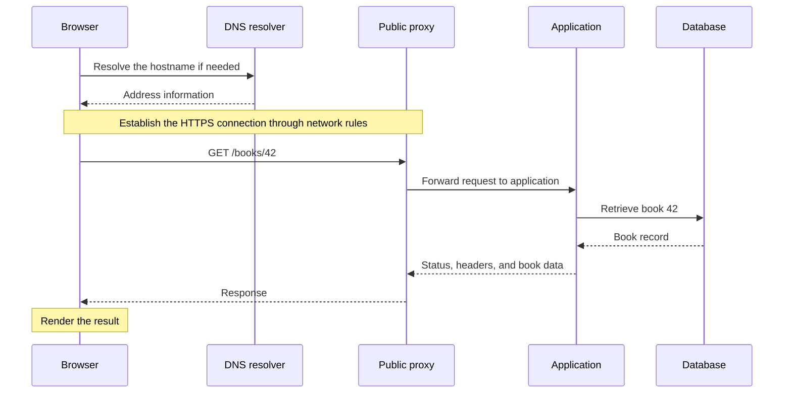
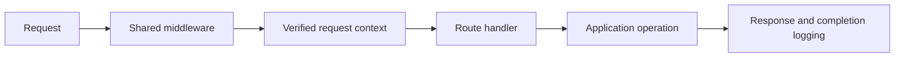
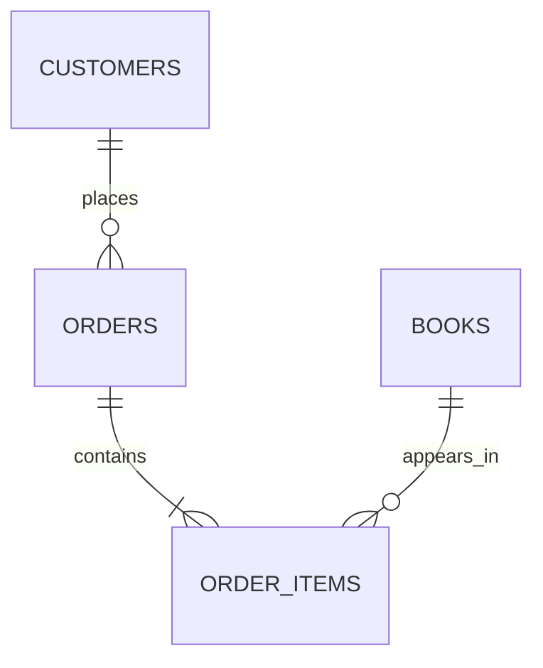
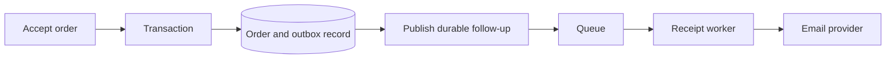

# Backend, Explained

### Things I brushed up on while preparing for a backend role

*By Jarvis Thuluri*

Preparing for a backend role sent me back through the fundamentals. I wanted to be able to follow a request, explain the decisions made along the way, and recognize what can go wrong when several requests arrive together.

These are the notes I wanted beside me. They start with what a server actually is, then connect HTTP, application code, databases, security, and operations through one small online bookstore.

The examples are illustrative designs. Limits, identifiers, and policies are chosen to make the reasoning concrete. The linked documentation provides the deeper technical detail, and my [Backend Engineering from First Principles series](https://github.com/jarvisthuluri/backend-from-first-principles) explores individual topics at greater length.

## Contents

1. [What the backend does](#1-what-the-backend-does)
2. [The vocabulary without the fog](#2-the-vocabulary-without-the-fog)
3. [Follow one request](#3-follow-one-request)
4. [Read an HTTP conversation](#4-read-an-http-conversation)
5. [Methods and status codes](#5-methods-and-status-codes)
6. [Routing and API design](#6-routing-and-api-design)
7. [JSON and serialization](#7-json-and-serialization)
8. [Validation and transformation](#8-validation-and-transformation)
9. [Authentication and authorization](#9-authentication-and-authorization)
10. [Sessions, cookies, tokens, and CORS](#10-sessions-cookies-tokens-and-cors)
11. [Middleware and request context](#11-middleware-and-request-context)
12. [Controllers, services, and repositories](#12-controllers-services-and-repositories)
13. [Database fundamentals](#13-database-fundamentals)
14. [Indexes, queries, and connection pools](#14-indexes-queries-and-connection-pools)
15. [Transactions and the last copy](#15-transactions-and-the-last-copy)
16. [Retries and idempotency](#16-retries-and-idempotency)
17. [Caching and stale information](#17-caching-and-stale-information)
18. [Queues, workers, and reliable follow-up](#18-queues-workers-and-reliable-follow-up)
19. [Timeouts and dependency failures](#19-timeouts-and-dependency-failures)
20. [Concurrency, parallelism, and scaling](#20-concurrency-parallelism-and-scaling)
21. [Files and live updates](#21-files-and-live-updates)
22. [Security in everyday decisions](#22-security-in-everyday-decisions)
23. [Deployment and observability](#23-deployment-and-observability)
24. [Testing the promises](#24-testing-the-promises)
25. [Put the whole checkout together](#25-put-the-whole-checkout-together)
26. [Questions I use to check my understanding](#26-questions-i-use-to-check-my-understanding)
27. [A small practice project](#27-a-small-practice-project)
28. [Sources and further reading](#28-sources-and-further-reading)

## 1. What the backend does

The frontend is the part of the application a person interacts with. In our shop, it shows books, accepts a shipping address, and displays an order confirmation.

The backend handles operations and shared state behind those interactions. It retrieves catalog data, determines whether a purchase is permitted, records an accepted order, and coordinates the work that follows.

A browser can immediately show that a customer clicked Buy. The backend must decide whether the purchase actually succeeds. The difference becomes interesting when the shop has one copy left and two customers with excellent taste.

The database commonly stores durable records. Other components may provide search, caching, file storage, or background execution. A small backend can begin with one application and one database. The architecture should grow in response to actual needs. [Client-server overview](https://developer.mozilla.org/en-US/docs/Learn_web_development/Extensions/Server-side/First_steps/Client-Server_overview)

## 2. The vocabulary without the fog

| Term | Plain-language meaning | In the bookstore |
| --- | --- | --- |
| Client | A program requesting something | Browser, mobile app, or staff tool |
| Server | A machine or a program serving requests, depending on context | The computer and the listening application process |
| API | An interface defining available operations and their contracts | Retrieve a book or submit an order |
| Endpoint | A particular API operation, commonly identified by method and path | `GET /books/42` |
| Database | A system for storing and querying organized data | Books, customers, and orders |
| Runtime | The environment executing application code | A Python interpreter, JVM, or Node.js runtime |
| Framework | Tools and conventions for building an application | Routing, request parsing, response handling |
| Process | A running instance of a program | One running bookstore application |
| Dependency | Something an operation relies on | Database, payment service, or email provider |

An API can exist without HTTP, and a backend can serve clients other than browsers. Those words describe responsibilities and interfaces rather than one mandatory technology stack.

## 3. Follow one request

Suppose the customer opens a book page. The browser needs data from `https://api.example.com/books/42`.



DNS helps resolve a hostname to address information. The HTTP request subsequently travels to the destination, rather than through DNS as an application proxy. Cached information may avoid a new lookup.

An IP address identifies a network destination. A port identifies a service endpoint there. Network rules must permit traffic, and a process must be listening. HTTPS typically uses port 443. A reverse proxy can accept public connections and forward work to an internal application port.

`localhost` refers to the machine making the connection. On your laptop it means your laptop. In the deployed server environment it means that environment. Confusing the two is an efficient way to send a perfectly good request to the wrong computer.

## 4. Read an HTTP conversation

An HTTP request has a method, target, headers, and sometimes content. The response has a status, headers, and sometimes content. Here is an illustrative HTTP/1.1 representation.

```http
GET /books/42 HTTP/1.1
Host: api.example.com
Accept: application/json
```

```http
HTTP/1.1 200 OK
Content-Type: application/json

{"id":42,"title":"The Patient Bookseller","stock":1}
```

`Accept` expresses a response preference. `Content-Type` describes the content actually supplied. Other headers carry credentials, caching instructions, or representation metadata.

HTTP is stateless. One request does not automatically make a later request part of the same authenticated interaction. Applications establish continuity using mechanisms such as sessions and credentials. Stateless HTTP can still sit in front of a database full of persistent orders.

HTTPS uses TLS to protect communication in transit and authenticate the server under the certificate system. The Network tab makes application messages visible. HTTP/2 and HTTP/3 use different wire formats while retaining familiar methods and status semantics. [HTTP overview](https://developer.mozilla.org/en-US/docs/Web/HTTP/Guides/Overview)

## 5. Methods and status codes

| Method | Typical intent | Example |
| --- | --- | --- |
| GET | Retrieve a representation | View a book |
| HEAD | Retrieve response metadata without the response body | Check a resource’s metadata |
| POST | Submit data for processing | Place an order |
| PUT | Create or replace state at a known target | Replace a reading list |
| PATCH | Apply changes | Change a book description |
| DELETE | Remove the target’s current association or functionality | Remove a reading list |
| OPTIONS | Ask about communication options | Browser CORS preflight |

Safe methods have essentially read-only intended semantics. Idempotent methods have the same intended server effect when an identical request repeats. DELETE can be idempotent even if a later attempt returns a different status because the item is already gone.

| Status | How to read it |
| --- | --- |
| 200 | Successful operation |
| 201 | Resource created |
| 204 | Successful response without content |
| 304 | Reuse a stored representation after conditional validation |
| 400 | Bad request |
| 401 | Valid authentication is required |
| 403 | Operation is forbidden |
| 404 | Resource not found |
| 409 | Conflict with the current state |
| 422 | Content could not be processed according to its semantics |
| 429 | Request limit exceeded |
| 500 | Unexpected server failure |
| 502 / 504 | Gateway received an invalid upstream response / timed out |
| 503 | Service temporarily unavailable |

The status and body should agree. Returning 200 with an error hidden inside the content makes clients invent a second success-detection system. [HTTP semantics](https://www.rfc-editor.org/rfc/rfc9110.html)

## 6. Routing and API design

Routing selects a handler using the request’s method and path. `GET /books` and `POST /books` share a path but express different operations.

For `GET /books/42`, the path identifies a book. For `/books?category=history&page=2&limit=20`, query parameters refine retrieval. The application must define defaults, allowed sort values, limits, and pagination behavior.

A nested path such as `/customers/17/orders/903` suggests a relationship. The server still needs to verify that relationship and the caller’s access.

API design is a commitment to callers. Define input, output, errors, permissions, and compatibility. Changing a field’s meaning can break a client even if its name remains the same. Pagination also needs stable ordering so customers do not repeatedly see the same books while navigating.

REST is an architectural style with constraints beyond choosing plural nouns for URLs. For a first API, consistent resource-oriented operations and honest HTTP behavior provide a useful place to begin. [Routing concepts](https://expressjs.com/en/guide/routing/)

## 7. JSON and serialization

Serialization converts a program value into a transferable or storable representation. Deserialization reads that representation into values the receiving program can use.

JSON supports objects, arrays, strings, numbers, booleans, and null. A Python server and a JavaScript browser can agree on JSON even though their internal types differ.

```json
{
  "bookId": "book_42",
  "quantity": 2,
  "giftWrap": false,
  "message": null
}
```

JSON text has rules, including double-quoted object names and no trailing commas. Dates and money need application conventions because JSON does not provide a built-in date or decimal-money type. Large numeric identifiers may need string representations to preserve meaning across languages.

Successful parsing means the message follows the representation’s syntax. It says nothing yet about whether `quantity` is acceptable. [JSON standard](https://www.rfc-editor.org/rfc/rfc8259.html)

## 8. Validation and transformation

Our order contract accepts known book identifiers and integer quantities between 1 and 10. That limit is an example policy.

| Input | What we check |
| --- | --- |
| Body | Required fields, allowed properties, types, collection sizes |
| Path | Identifier structure and allowed values |
| Query | Parsing rules, ranges, defaults, repeated parameters |
| Headers | Required metadata and supported formats |

Transformation converts a permitted external representation into the expected internal one. A query value such as `page=2` begins as text. Define what numeric strings are accepted before conversion, and reject `2abc` if the contract requires a whole integer.

Defaults require care. Missing, null, empty string, zero, and false are different values. JavaScript’s `Boolean("false")` produces true because a nonempty string is truthy.

Frontend checks give immediate feedback. Server checks enforce the input contract regardless of which client makes the request. Database constraints protect the stored state too. Validation also cannot replace parameterized SQL or output encoding. [Input validation guidance](https://cheatsheetseries.owasp.org/cheatsheets/Input_Validation_Cheat_Sheet.html)

## 9. Authentication and authorization

Authentication establishes who is calling. Authorization determines what that caller may do to the relevant resource.

Our customer can be authenticated and still lack permission to view someone else’s order. A valid administrator credential may still be restricted to one organization. A hidden button cannot enforce either rule.

Store passwords with an appropriate password-hashing mechanism and salts, using maintained libraries. Keep login failures suitably generic, account for timing differences, and add protections such as throttling and multifactor authentication where appropriate. [Authentication guidance](https://cheatsheetseries.owasp.org/cheatsheets/Authentication_Cheat_Sheet.html)

For each protected operation, evaluate the caller, action, resource, and relevant conditions. Use the verified identity from authentication when assigning order ownership. Treat a caller-supplied customer ID as an input to check, rather than proof of ownership. [Authorization guidance](https://cheatsheetseries.owasp.org/cheatsheets/Authorization_Cheat_Sheet.html)

## 10. Sessions, cookies, tokens, and CORS

These terms answer different questions.

| Term | Responsibility |
| --- | --- |
| Session | Maintain server-side context across interactions |
| Cookie | Store and send information according to browser rules |
| JWT | Represent claims in a token format |
| API key | Identify or authorize a programmatic caller under a defined policy |
| OAuth | Delegate access to resources |
| OpenID Connect | Provide an identity layer on OAuth 2.0 |

A cookie can carry a session identifier or a token. Secure, HttpOnly, and SameSite attributes affect its handling. A session needs expiry, invalidation, and appropriate storage. [Cookie guide](https://developer.mozilla.org/en-US/docs/Web/HTTP/Guides/Cookies)

A signed JWT is commonly encoded rather than encrypted. Reading its payload does not verify it. A verifier must enforce algorithm, key, issuer, audience, and time requirements. Self-contained verification also needs a plan for revocation and changing permissions. [JWT best practices](https://www.rfc-editor.org/rfc/rfc8725.html)

CORS concerns browser access to cross-origin responses. Origins include scheme, host, and port. Some requests require a preflight. Permitting a browser origin does not authorize the customer, and a CORS error does not prove that a side effect never occurred. [CORS guide](https://developer.mozilla.org/en-US/docs/Web/HTTP/Guides/CORS)

## 11. Middleware and request context

Middleware performs reusable work during request handling, such as authentication, logging, parsing, and response policy. It may continue execution or return early. Its order determines which information is available to the next component.

Request context carries appropriately scoped metadata such as the verified actor, request ID, trace information, and cancellation signal. Keep one request’s information isolated from other concurrent requests. A global `currentUser` is unsafe when requests interleave.



The diagram describes responsibilities, rather than a universal framework order. Different frameworks use forward chains, wrappers, or response hooks. Error handling and continuation must follow their actual rules. [Middleware guide](https://expressjs.com/en/guide/using-middleware/)

## 12. Controllers, services, and repositories

| Layer | Job | Bookstore example |
| --- | --- | --- |
| Controller or handler | Adapt HTTP input and output | Read order input and return 201 |
| Service | Coordinate the application operation | Check purchase rules and accept the order |
| Repository | Encapsulate persistence operations | Retrieve books and store order records |

This separation helps when another entry point needs the same purchase operation. A staff tool should not need to manufacture an HTTP response object just to place an order.

The service can coordinate several persistence calls within a transaction. The handler translates the outcome into the public API contract. A repository needs clear inputs, return types, and persistence guarantees.

The pattern should make dependencies easier to follow. A method that merely forwards three arguments through five files may have achieved separation more literally than helpfully. [Service Layer pattern](https://martinfowler.com/eaaCatalog/serviceLayer.html)

## 13. Database fundamentals

Relational databases organize data into tables with rows and columns. Keys identify records and relationships. Constraints express rules about stored values.



In this example, each accepted order belongs to a customer and contains line items. A line item records the book, quantity, and accepted price. Storing the accepted price preserves the order history when the catalog price later changes.

Primary keys identify rows. Foreign keys enforce references. Unique constraints prevent defined duplicates. Check constraints can express conditions such as a nonnegative stock count. Choose nullability intentionally. [PostgreSQL constraints](https://www.postgresql.org/docs/current/ddl-constraints.html)

Normalization reduces repeated facts that would otherwise need coordinated updates. Denormalized representations can support specific access patterns, but they need a consistency plan. SQL versus NoSQL is also a choice about data models, query patterns, guarantees, and operational needs. Both labels cover systems with substantial differences.

## 14. Indexes, queries, and connection pools

An index provides an access structure that can make suitable queries faster. It also consumes space and adds maintenance work when data changes. Choose indexes for actual predicates, joins, and ordering, then inspect query plans. The database may still choose a sequential scan when that is cheaper. [PostgreSQL indexes](https://www.postgresql.org/docs/current/indexes-intro.html)

Watch for the N+1 query pattern. Loading 50 orders and then making one additional query for each order can produce 51 queries. A deliberate join or batched retrieval may reduce overhead, depending on the result shape and data volume.

A connection pool maintains a bounded set of reusable database connections. Work borrows a connection and returns it. Per-instance limits multiply across application instances, so adding servers can exhaust the database connection budget. A pool wait can also consume much of a request’s latency before the query even starts. [Connection pooling](https://node-postgres.com/features/pooling)

## 15. Transactions and the last copy

Imagine two customers both read that one copy remains. Each then places an order. A read followed by an independent write can oversell the book.

A transaction groups changes into a commit or rollback. It can ensure that recording the order and changing stock happen together. Atomicity alone does not explain the concurrent behavior. Choose appropriate locking, conditional updates, isolation, and retry handling. [PostgreSQL transactions](https://www.postgresql.org/docs/current/tutorial-transactions.html)

One design can use a conditional stock update. The following is pseudocode for a single-item order, rather than executable SQL.

```text
begin transaction
    reduce stock only where book matches and stock >= requested quantity
    if no row was updated
        roll back and report that the purchase cannot be accepted
    insert the order and line item using authoritative prices
commit
```

The affected-row check matters. So does rolling back if the later insert fails. A multi-item order adds lock-ordering and contention concerns, and serialization failures can require retrying the whole transaction. [Transaction isolation](https://www.postgresql.org/docs/current/transaction-iso.html)

## 16. Retries and idempotency

The server commits an order, then the connection drops before the response reaches the customer. The customer sees a timeout and tries again. The first attempt may already have succeeded.

An idempotency key can identify repeated attempts at the same logical submission. A robust design associates it with the caller and operation, records the relevant payload identity, and returns the established result for a matching retry. Reusing the key with a different payload needs a defined error.

Two concurrent attempts with the same key must not both execute independently. Use an atomic claim and durable outcome strategy. Also define in-progress handling, retention, failure behavior, and any external provider guarantees. A key placed in a header without this server behavior is simply a very confident string. [Idempotent request example](https://docs.stripe.com/api/idempotent_requests)

## 17. Caching and stale information

A cache stores data so later work can reuse it. The engineering question is how old that data may be and what makes it invalid.

Public descriptions can often tolerate a different freshness policy from checkout stock. For our design, a displayed availability hint does not replace the authoritative check when accepting the purchase.

In cache-aside, the application checks the cache, fetches on a miss, and stores the result. Expiry bounds some stale lifetimes, while updates may need invalidation or replacement. Design keys to include relevant variations, including tenant and access scope, so one customer’s data cannot become another customer’s cache hit. [Cache-aside pattern](https://learn.microsoft.com/en-us/azure/architecture/patterns/cache-aside)

HTTP caching adds response-level policy. Fresh stored responses may be reused directly. Conditional requests with validators such as ETags can yield 304. `no-cache` requires validation before reuse, while `no-store` directs caches not to store. [HTTP caching](https://developer.mozilla.org/en-US/docs/Web/HTTP/Guides/Caching)

## 18. Queues, workers, and reliable follow-up

Recording an order and sending its receipt have different latency and durability needs. A worker can send the receipt after checkout returns, then retry if the provider is temporarily unavailable.



The gap between a database commit and an ordinary queue send is a failure window. A transactional outbox stores the order change and follow-up record together, then publishes separately. Publishing can repeat, so consumers need duplicate-handling behavior. [Transactional outbox](https://docs.aws.amazon.com/prescriptive-guidance/latest/cloud-design-patterns/transactional-outbox.html)

Specify acknowledgments, retry limits, backoff, poison-message handling, and monitoring. A background job is accepted work with a later execution time. It still needs an owner when it fails.

## 19. Timeouts and dependency failures

Every remote dependency can be slow, unreachable, or inconsistent with our expectations. Set a request time budget and allocate sensible timeouts to downstream calls.

Retry only where the operation and failure mode make it appropriate. Use bounded attempts, backoff, and jitter to avoid turning one overloaded service into a synchronized retry event. A circuit breaker can temporarily stop calls to a failing dependency, while concurrency limits prevent one dependency from consuming every available resource. [Retry pattern](https://learn.microsoft.com/en-us/azure/architecture/patterns/retry)

Cancellation is cooperative. Passing a signal helps only when downstream work observes it. A disconnected customer also does not prove that a committed order was undone. For uncertain outcomes, provide a way to retrieve the order state safely.

## 20. Concurrency, parallelism, and scaling

Concurrency means dealing with overlapping work. Parallelism means executing work simultaneously. An application can overlap I/O waits without executing all its business code on multiple CPU cores.

Asynchronous code can improve resource use for I/O-bound work, but CPU-heavy computation can still block an event loop. Threads, processes, workers, and runtime-specific facilities offer different options. Measure the actual bottleneck before changing the execution model. [Node.js event-loop guidance](https://nodejs.org/en/learn/asynchronous-work/dont-block-the-event-loop)

Vertical scaling increases a machine’s resources. Horizontal scaling adds application instances. A load balancer distributes traffic, while shared data and session requirements need deliberate handling. Local memory differs between instances.

More application instances may increase load on the same database. More workers may overload an email provider. Measure throughput, latency distributions, errors, saturation, and dependency capacity. Scaling a queue of requests faster toward the bottleneck is still movement, but the customer may not share our enthusiasm.

## 21. Files and live updates

Book covers and downloadable files can live in object storage, with the database holding their identifiers and metadata. Define upload size limits, access policy, file checks, naming, and lifecycle. Keep public catalog images separate from private customer documents. [File upload guidance](https://cheatsheetseries.owasp.org/cheatsheets/File_Upload_Cheat_Sheet.html)

For changing order status, polling makes repeated requests. Server-sent events support server-to-browser event delivery over an HTTP response. WebSockets provide bidirectional communication. The choice depends on update frequency, direction, operational constraints, and recovery behavior. Reconnection still needs a plan for missed or duplicate events. [Server-sent events](https://developer.mozilla.org/en-US/docs/Web/API/Server-sent_events/Using_server-sent_events)

## 22. Security in everyday decisions

Security is present in ordinary implementation choices.

- Parameterize SQL values and allowlist dynamic query structure.
- Enforce resource and organization boundaries on the server.
- Keep secrets outside public source code and rotate them when needed.
- Limit request size, resource consumption, and expensive operations.
- Treat externally supplied URLs carefully before fetching them.
- Encode output for its destination and use appropriate browser protections.
- Apply maintained dependencies and least-privilege service credentials.
- Avoid recording passwords, access tokens, or unnecessary personal data in logs.

These controls address different failure modes. Validation, authentication, authorization, encryption, and rate limiting each answer a different question. [REST security guidance](https://cheatsheetseries.owasp.org/cheatsheets/REST_Security_Cheat_Sheet.html)

## 23. Deployment and observability

Deployment puts a version of the application into an environment with configuration, secrets, networking, runtime dependencies, and a way to start and supervise its processes.

A container packages an application and its environment. It still needs infrastructure, storage decisions, resource limits, and maintenance. Keep configuration appropriate to the environment and make database migrations compatible with the rollout plan.

Graceful shutdown stops accepting new work, drains or terminates in-flight work according to policy, and closes resources. Background work and requests both need bounded shutdown behavior. Readiness and health checks should reflect their intended operational purpose. [Kubernetes probe concepts](https://kubernetes.io/docs/concepts/configuration/liveness-readiness-startup-probes/)

Observability helps investigate the system through emitted evidence. Logs describe events, metrics summarize measurements, and traces connect operations along a request path. Correlate useful identifiers while protecting sensitive information. [Observability primer](https://opentelemetry.io/docs/concepts/observability-primer/)

If checkout slows, separate queueing, application execution, database time, and external calls. Averages can hide bad experiences for a minority of customers, so percentiles and distributions matter too. Instrumentation should help test a hypothesis about the failure.

## 24. Testing the promises

| Test level | A question worth asking |
| --- | --- |
| Unit | Does this pricing rule produce the accepted total? |
| Integration | Does this query enforce the intended database behavior? |
| API | Are status, schema, permissions, and errors correct? |
| End-to-end | Can a customer complete the workflow? |
| Concurrency | Can two customers purchase the last copy? |
| Failure handling | What happens if the provider times out after accepting work? |

Test observable guarantees. For checkout, important cases include a repeated idempotency key, a changed payload with that key, a database failure before commit, and a dropped connection after commit. Authorization tests should include another customer’s valid identifiers.

Mocks help isolate application decisions. They cannot establish the locking and transaction behavior of the real database. A passing happy-path test does not answer the last-copy question merely because the test name contains the word checkout.

## 25. Put the whole checkout together

Here is our illustrative flow. The order of individual request checks may differ in a concrete framework.

1. The browser submits book identifiers and quantities over HTTPS.
2. Entry controls establish request context and enforce resource limits.
3. Authentication establishes the caller, and the input pipeline parses and validates the payload.
4. Authorization checks the requested operation and related resources.
5. The application resolves the idempotency policy for this submission.
6. The purchase operation reads authoritative prices and updates inventory safely.
7. A transaction stores the order, line items, and required durable follow-up information.
8. The server returns the established outcome using the public response contract.
9. A worker processes the receipt with controlled retries and duplicate handling.
10. Logs, metrics, and traces let us investigate the complete operation.

An example submission might look like this. The hostname, token, key, and item are placeholders.

```bash
curl --request POST 'https://api.example.com/orders' \
  --header 'Authorization: Bearer <access-token>' \
  --header 'Content-Type: application/json' \
  --header 'Idempotency-Key: <unique-key-for-this-purchase>' \
  --data '{"items":[{"bookId":"book_42","quantity":1}]}'
```

The client does not choose the authoritative total or prove its identity by submitting a customer ID. The operation’s server-side rules determine those facts.

## 26. Questions I use to check my understanding

| Question | What a useful answer should explain |
| --- | --- |
| What happens after a browser requests a book? | DNS, connection, proxy, application, data access, response |
| How can HTTP be stateless while a customer remains logged in? | Protocol semantics and application-managed continuity |
| What distinguishes authentication and authorization? | Identity versus permitted action on a resource |
| Does valid JSON mean valid order input? | Parsing versus schema and business rules |
| Why is a global current-user variable unsafe? | Interleaving and request isolation |
| Why does a transaction need concurrency reasoning? | Atomicity, isolation, contention, and invariant protection |
| Can DELETE be idempotent if the response changes? | Intended state effect versus response identity |
| What if a POST times out? | Uncertain outcome, safe retry, and durable lookup |
| Why can more API servers make things slower? | Shared dependency budgets and contention |
| What is safe to cache? | Freshness tolerance, identity scope, and authoritative checks |
| Why can a receipt job run twice? | Delivery guarantees, acknowledgment, and duplicate handling |
| Where would you look for a slow request? | Evidence that separates waiting from execution |

I try to answer these using an actual sequence of events. Definitions become much more useful when they survive a retry, a second customer, and a failed dependency.

## 27. A small practice project

Build a small bookstore API in a stack you can explain. Start with a catalog and a database. Add complexity when a new requirement gives it a purpose.

| Stage | Build | Explain before moving on |
| --- | --- | --- |
| 1 | List books and retrieve one book | Routes, JSON, status codes, and missing records |
| 2 | Validate catalog creation | Allowed fields, types, errors, and database constraints |
| 3 | Add customer identity and protected orders | Sessions or tokens, ownership, and access checks |
| 4 | Place an order safely | Transactions, last-copy concurrency, authoritative prices |
| 5 | Handle repeated submissions | Idempotency scope and uncertain outcomes |
| 6 | Send receipts asynchronously | Durable handoff, acknowledgment, retries, duplicates |
| 7 | Operate the service | Configuration, migrations, logs, metrics, timeouts, shutdown |

Keep a record of decisions and tradeoffs. An explanation of why a simple design meets the requirements is more useful than a diagram containing every tool I have ever heard of.

## 28. Sources and further reading

This guide is an original synthesis of concepts I revisited while preparing for a backend role. Sriniously’s [Backend from First Principles playlist](https://www.youtube.com/playlist?list=PLui3EUkuMTPgZcV0QhQrOcwMPcBCcd_Q1) has been a central part of that revision. The references linked throughout support specific mechanisms and provide fuller definitions.

- [MDN web documentation](https://developer.mozilla.org/en-US/docs/Web/HTTP/Guides/Overview) for browser and HTTP behavior.
- [PostgreSQL documentation](https://www.postgresql.org/docs/current/) for data constraints, transactions, query planning, and concurrency.
- [OWASP Cheat Sheet Series](https://cheatsheetseries.owasp.org/) for application security guidance.
- [OpenTelemetry concepts](https://opentelemetry.io/docs/concepts/) for telemetry and distributed context.
- [My detailed backend series](https://github.com/jarvisthuluri/backend-from-first-principles) for the continuing bookstore articles.

Corrections and questions are welcome through repository issues. My goal is to make the reasoning clear enough to examine, discuss, and improve.
